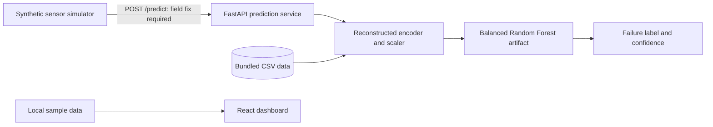

# maintain-ai

**A predictive-maintenance prototype with a machine-failure API, a React operations dashboard, and a synthetic sensor simulator.**

maintain-ai explores how machine readings can support maintenance decisions. Its FastAPI service loads a saved Balanced Random Forest classifier and returns a binary failure label with a confidence score. A React dashboard presents equipment health, sensor charts, predictions, alerts, maintenance history, and reporting interactions. A separate simulator generates sample machine readings.

**Current implementation:** the prediction API runs independently. The dashboard uses local sample data and does not call the API. The simulator has a request-field mismatch, and inference preprocessing has inconsistencies that must be resolved before relying on predictions. This README describes the shipped behavior rather than treating dashboard values as measured operational results.

## Contents

- [Capabilities](#capabilities)
- [Architecture](#architecture)
- [Local setup](#local-setup)
- [Prediction API](#prediction-api)
- [Dashboard](#dashboard)
- [Simulator](#simulator)
- [Data and model workflow](#data-and-model-workflow)
- [Repository structure](#repository-structure)
- [Validation](#validation)
- [Known limitations](#known-limitations)
- [Development priorities](#development-priorities)

## Capabilities

| Component | Implemented scope |
| --- | --- |
| Prediction service | Validates a sensor-reading request, preprocesses it, and predicts `Failure` or `No Failure`. |
| Model artifacts | Includes a deployed Balanced Random Forest artifact and several notebook experiment artifacts. |
| ML utilities | CSV loading, duplicate removal, column selection, one-hot encoding, SMOTE balancing, scaling, training, evaluation helpers, and joblib persistence. |
| Dashboard | Sample equipment status, sensor visualizations, failure-risk displays, alerts, maintenance records, settings, and reports. |
| Simulator | Generates readings for four synthetic machines, injects occasional anomalies, and posts each reading to the API. |
| Notebooks | Exploratory analysis, logistic regression, and ensemble-model experiments with saved outputs. |

There is no database, production authentication, live sensor ingestion platform, or implemented time-to-failure API. Dashboard scheduling and settings interactions are local demonstrations rather than persisted operational workflows.

## Architecture



| Layer | Technology |
| --- | --- |
| Dashboard | React 19, React Router 7, Vite 7 |
| UI and charts | Tailwind CSS 4, Recharts 3, Lucide |
| API | FastAPI, Pydantic, Uvicorn |
| ML | scikit-learn, imbalanced-learn, XGBoost, joblib |
| Data and experiments | pandas, NumPy, matplotlib, seaborn, Jupyter notebooks |
| Simulator | Python, requests, and an optional FastAPI wrapper |

The API loads the model once during application startup. Its preprocessor reconstructs fitted objects from `backend/data/scaled_dataset.csv` on each startup rather than loading a single persisted inference pipeline.

## Local setup

### Requirements

- Python 3.11 as a tested starting environment.
- Node.js 20.19+ or 22.12+ with npm for Vite 7.
- A platform capable of installing the data-science dependencies.

No database or external AI-provider key is required. The backend dependency list uses minimum versions, so installations may differ. The saved estimator reports scikit-learn 1.8.0 as its serialization version; newer versions can emit compatibility warnings.

### Clone and start the API

```bash
git clone https://github.com/quixoticalcoder/maintain-ai.git
cd maintain-ai
python3 -m venv .venv
source .venv/bin/activate
pip install -r backend/requirements.txt
cd backend
python -m uvicorn main:app --host 127.0.0.1 --port 8000
```

On Windows, activate the environment with `.venv\Scripts\activate`.

Open `http://127.0.0.1:8000/docs` for the generated API schema. There is no custom root or health endpoint on the prediction service. Its model and data paths resolve relative to `backend/`, and request/error logs are written to `backend/logs/app.log`.

### Start the dashboard

In another terminal, from the repository root:

```bash
cd frontend
npm ci
npm run dev
```

Open the URL printed by Vite, normally `http://localhost:5173`. The frontend can be explored without the API because its current screens use sample data. No API URL environment variable or integration client is implemented.

## Prediction API

### `POST /predict`

The request accepts Python-style field names and the listed aliases for sensor measurements. `type` must be exactly `L`, `M`, or `H`.

| Field | Accepted alias | Meaning |
| --- | --- | --- |
| `product_id` | No alternate alias | Product identifier; dropped before classification. |
| `type` | No alternate alias | Product quality category: L/M/H. |
| `air_temperature` | `Air temperature K` | Air temperature in Kelvin. |
| `process_temperature` | `Process temperature K` | Process temperature in Kelvin. |
| `rotational_speed` | `Rotational speed rpm` | Rotational speed in RPM. |
| `torque` | `Torque Nm` | Torque in newton-metres. |
| `vibration_levels` | `Vibration Levels` | Vibration reading; source units are not specified. |
| `operational_hours` | `Operational Hours` | Accumulated operating hours. |

Example:

```bash
curl -X POST http://127.0.0.1:8000/predict \
  -H 'Content-Type: application/json' \
  -d '{
    "product_id": "L47471",
    "type": "L",
    "air_temperature": 300.0,
    "process_temperature": 310.0,
    "rotational_speed": 1500,
    "torque": 40.0,
    "vibration_levels": 0.02,
    "operational_hours": 1200
  }'
```

Response shape:

```json
{
  "prediction": "No Failure",
  "confidence": 0.5408
}
```

That response was observed for the example during a local smoke check. It is not a calibrated reliability claim or a guarantee across dependency versions. Confidence is the maximum class probability returned by the estimator, rounded to four decimal places. It is the probability assigned to the predicted class, not always the probability of failure.

Missing fields and an invalid quality type produce HTTP 422. Runtime inference errors produce HTTP 500 with exception details. The endpoint does not impose meaningful physical ranges on sensor values or require authentication. Browser CORS support is not configured.

## Dashboard

| Route | Screen |
| --- | --- |
| `/`, `/dashboard` | Equipment summary and sample health metrics |
| `/sensors` | Sample sensor readings and charts |
| `/predictions` | Demonstration prediction/risk displays |
| `/maintenance-history` | Sample maintenance records and local interactions |
| `/alerts` | Sample alerts and equipment details |
| `/machine/:id` | Individual sample machine view |
| `/reports` | Sample report and analytics interface |
| `/settings` | Demonstration configuration controls |
| `/login` | Simulated login form |

`App.jsx` sets `isLoggedIn = true`. The login form waits briefly and accepts nonempty values; password recovery displays an alert rather than sending email. Demo credentials fill the form only. Displayed OEE, uptime, costs, technicians, health scores, and forecast values come from sample records or client-side calculations.

Personal names in sample records have been replaced with neutral operator labels. No account backend, persistence, or actual technician directory is implied.

## Simulator

Install its dependencies in the active virtual environment:

```bash
pip install -r simulator/requirements.txt
```

`simulator/simulator.py` defines four machines, increments their operational hours, samples readings, and injects occasional higher torque/vibration/temperature values. It sends requests sequentially with a five-second timeout and sleeps three seconds after a complete round. This is not a fixed three-second delivery interval under network delay.

**Current integration issue:** generated requests use `Product ID`, while the API requires `product_id`. Unmodified simulator requests receive HTTP 422. Align the key in `generate_machine_data()` and its logging reference before expecting successful predictions.

After addressing that mismatch, run from the repository root:

```bash
python simulator/simulator.py
```

For the optional web wrapper, run from `simulator/`:

```bash
python -m uvicorn main:app --host 127.0.0.1 --port 8001
```

Its root endpoint reports that the simulator is running. Startup launches a daemon thread; multiple server workers or restarts can create separate simulator loops. The prediction target is hardcoded to `http://127.0.0.1:8000/predict` in `simulator.py`.

The included Render configuration names the service `maintain-ai-simulator` and launches port 10000. It still requires an appropriate working directory and a reachable prediction URL; local loopback is not a remote deployment integration.

## Data and model workflow

| File | Included rows | Role |
| --- | --- | --- |
| `Predictive_Maintenance_dataset.csv` | 500 | Source dataset used in experiments. |
| `scaled_dataset.csv` | 1,000 | Dataset read by the inference preprocessor. |

Both CSVs include product identifiers, quality type, temperatures, speed, torque, vibration, hours, and `Failure Type`. Dataset provenance and a complete data-generation contract are not documented in the repository. The filename `scaled_dataset.csv` alone does not establish which transformations were applied.

The reusable training pipeline removes duplicate rows, drops `UDI` and `Product ID`, converts `Failure Type` into a binary target, and uses a stratified 80/20 split with random state 42. It one-hot encodes `Type`, applies configured SMOTE balancing to training data, and scales features.

The model factory supports `logistic`, `decision_tree`, and `svm`. Additional notebook artifacts include Random Forest, Balanced Random Forest, XGBoost, and a fine-tuned Balanced Random Forest. The deployed API selects only:

```text
backend/models/fine_tuned_balanced_random_forest_failure_prediction.joblib
```

There are no model-list or training HTTP endpoints. Use the notebooks and ML modules for experiments. Only load trusted joblib files, and preserve the original training environment when reproducing saved estimators.

## Repository structure

```text
maintain-ai/
├── backend/
│   ├── main.py                 Prediction service and lifespan loading
│   ├── api/                    Request/response schemas and preprocessing
│   ├── models/                 Deployed classifier
│   ├── data/                   Included CSV datasets
│   ├── notebooks/              EDA and model experiments
│   │   └── artifacts/          Saved experimental classifiers
│   ├── maintenance_ml/         Data, preprocessing, balancing, training utilities
│   └── requirements.txt
├── frontend/
│   ├── src/pages/              Dashboard screens and sample interactions
│   ├── src/components/         Navigation and sidebar
│   ├── src/App.jsx             Routes and demonstration login state
│   ├── package-lock.json
│   └── vercel.json             SPA fallback configuration
└── simulator/
    ├── simulator.py            Synthetic readings and POST loop
    ├── main.py                 Optional FastAPI wrapper
    ├── requirements.txt
    └── render.yaml
```

## Validation

Frontend checks:

```bash
cd frontend
npm run build
npm run lint
```

The production build passes with a large-bundle warning. ESLint currently reports 20 errors and 3 warnings in existing code.

Backend checks from the root, with the virtual environment active:

```bash
python -m pip check
python -m compileall -q backend simulator
```

During cleanup, an actual model smoke check returned HTTP 200 for a valid request and HTTP 422 for an invalid quality type. A generated simulator payload confirmed the existing field mismatch. The model emitted a scikit-learn serialization-version warning. These checks establish basic execution, not predictive validity. There is no committed automated test suite or CI workflow.

## Known limitations

- **Vibration column mismatch:** the bundled CSV header has a trailing space in `Vibration Levels `. The request DataFrame uses `Vibration Levels`. During feature alignment, the missing training-column name is filled with zero and the submitted vibration column is dropped.
- **Preprocessing consistency:** inference reconstructs its scaler on the training split without SMOTE, while the reusable training pipeline fits scaling after balancing. Exact equivalence with the deployed artifact is not established, and fitted transformations are not bundled with the model.
- **Simulator schema:** `Product ID` does not satisfy the required `product_id` field. The simulator's generated ranges are illustrative and not a validated representation of the training distribution.
- **Dashboard integration:** no frontend requests connect the displayed readings or predictions to the API. Displayed real-time updates and maintenance actions are demonstrations.
- **Authentication and logs:** login is simulated, the API is open, and the demo login handler logs entered values. API request payloads and errors are logged to disk.
- **Model reproducibility:** minimum-version dependencies can load a saved estimator under a different library version. A successful prediction does not resolve compatibility warnings or establish calibration.
- **Scope:** binary failure classification does not estimate remaining useful life, prescribe a maintenance schedule, or prove reduced downtime. Notebook plots and sample dashboard metrics should not be presented as operational evidence.

## Development priorities

First align field names and fix vibration handling. Persist the trained encoder, scaler, and classifier as one versioned inference pipeline, with regression tests for each input feature. Then connect the frontend to the API, configure CORS and API origins, and add durable records and real authentication where needed. Evaluate calibration and failure-detection performance on an independently defined test set before using the output for maintenance decisions.

## Contributing and license

Use `maintain-ai` consistently in project-facing text and configuration. Explain how each change affects the real API, the simulator, or the sample dashboard, and include relevant verification steps.

No project-wide license file is included. Review the rights for code, datasets, model artifacts, and third-party assets before reuse or redistribution.
